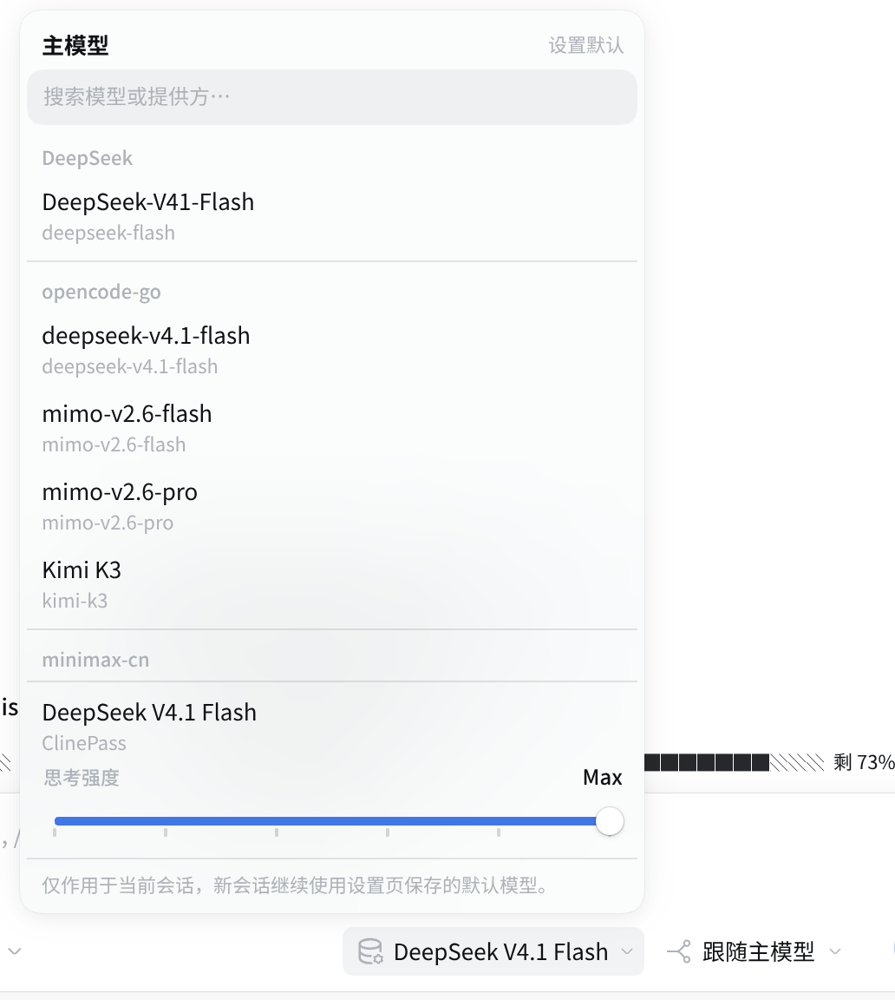
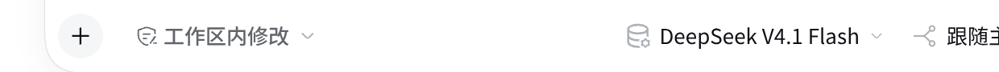
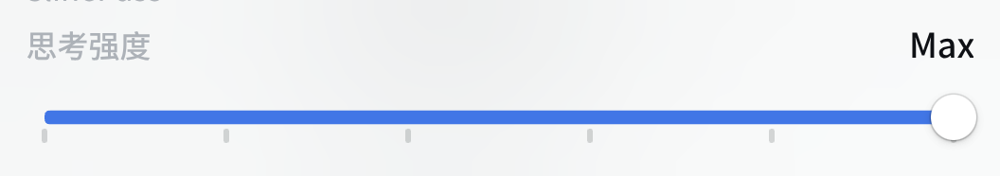
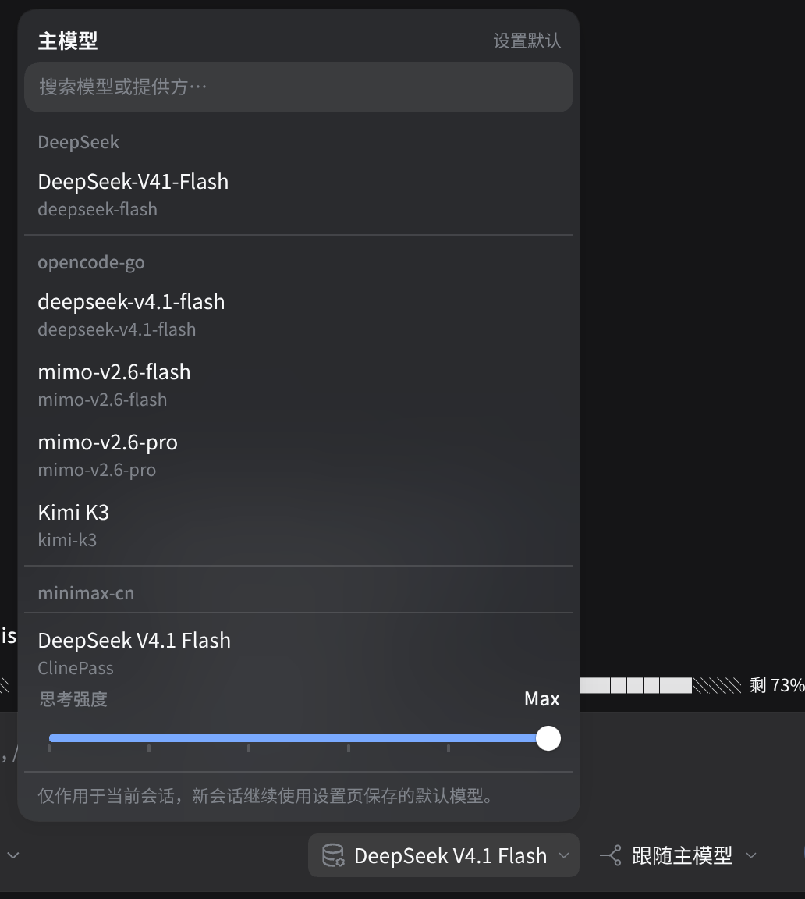

# dsh-plugin-model-dispatch

English | [简体中文](README_CN.md)

[](LICENSE)
[](https://github.com/deepseek-ai/deepseek-harness)
[]()
[](tests)

**Give the main model, your subagents, and plan mode their own model and reasoning effort — from the chat bar, in one menu.**



DeepSeek Harness ships a model picker for the **main** model. This plugin keeps that control and adds the two routes it does not cover — the model that **delegated subagents** run on, and the model **plan mode** thinks with — then puts all three in one menu that behaves like a native control.

| Route | Set it from | Applies to |
|---|---|---|
| **Main model** | chat-bar main chip · settings row 1 | the current session, through the native DSH switching API |
| **Subagent model** | chat-bar subagent chip · settings row 2 | subagents started *later* in this session |
| **Planning model** | settings row 3 | plan mode only; the pre-plan main model is restored afterwards |

---

## Table of contents

- [Features](#features)
- [Install](#install)
- [Usage](#usage)
  - [Chat bar](#chat-bar)
  - [Settings](#settings)
  - [Plan mode](#plan-mode)
  - [Subagents](#subagents)
- [Routing rules](#routing-rules)
- [Persistence](#persistence)
- [Compatibility](#compatibility)
- [Development](#development)
- [Troubleshooting](#troubleshooting)
- [Known limitations](#known-limitations)
- [Credits](#credits)
- [License](#license)

## Features

- **Two composer chips, wearing the host's own material.** The input bar carries a main chip (the host's model glyph) and a subagent chip (a branch glyph); the icon alone tells them apart, while the tooltip and accessible name keep the full `Main · model · effort` label. Both are borderless 28px chips that only show a surface on hover, exactly like the neighbouring native controls. While the subagent route inherits, its chip reads **Follows main** instead of repeating the main model name.

  

- **One menu for every route.** Search across models and providers, provider groups, favorites, recents, and reasoning effort — the same menu is used by the chat bar and the settings rows. It is built from the host menu's material (translucent blurred card, elevation shadow, 4px padding, 34px rows, 13px type, l2 hairlines), so it reads as a first-party control rather than a plugin overlay.

- **Reasoning effort as a discrete slider.** One stop per level, plus a leading **provider default** stop so "don't specify an effort" is a visible state instead of hidden behaviour. The scale is drawn under the rail (so it never seams the filled run), the current level is named in the header row, and the control is draggable and keyboard-operable.

  

- **Live apply — no confirm row.** A model pick, a slider move, or a restore writes through immediately. A slider drag coalesces into a single write when it settles, writes are serialized, and a failed write rolls the row back and shows the real error. The menu stays open, so picking a model can be followed straight by an effort change; `Esc` or a click outside only closes the menu and never undoes a live choice.

- **Plan-mode auto switching.** Entering plan mode switches to the planning model; approving the plan or `/plan off` restores the pre-plan main model *and* effort before the first execution request. The review panel shows which model will be restored.

- **Per-session subagent overrides.** A chat-bar subagent pick is stored as a durable override for that session and never touches the settings default; one click restores the settings default.

- **Every catalog model is delegatable.** Subagent routing reads the host's live model catalog, so an explicit child selection and `list_subagent_models` keep working in existing sessions even when rc.2 captured an older allowlist. Models added later are available on the next delegation; removed routes and unsupported efforts are rejected up front.

- **Route validation before saving.** Overrides and child creation validate the exact provider/model/effort through the host's `resolveCallConfig`; an invalid combination fails immediately with the real reason instead of failing inside a run.

## Install

Requires **DeepSeek Harness 0.2.0-rc.2** (other 0.2.x versions need a compatibility check — see [Compatibility](#compatibility)).

```bash
dsh plugin --profile web add git@github.com:kolawong/dsh-plugin-model-dispatch.git
```

Replace `web` with the profile you actually use (`desktop`, …). Then **fully quit and reopen DSH**: the host half needs a recomposition, and refreshing the page only reloads the client half.

`lib/` is not tracked in git: git installs build the host and client bundles through the package's `prepare` script, and npm publishes build through `prepack`. For a local checkout, run `pnpm install && pnpm build` once before linking.

<details>
<summary>Manual install (link a local checkout)</summary>

```jsonc
// <DSH_HOME>/profiles/<profile>/package.json
{
  "dependencies": { "dsh-plugin-model-dispatch": "link:/path/to/dsh-plugin-model-dispatch" },
  "dsh": { "profile": { "bundles": ["…", "dsh-plugin-model-dispatch"] } }
}
```

In the checkout, run `pnpm install && pnpm build` first, then create the matching `node_modules` link (the profile directory is the resolution anchor), then restart DSH.
</details>

## Usage

### Chat bar

Two chips sit at the right of the composer, next to the permission and preset controls:

| Chip | What it does |
|---|---|
| **Main** (model glyph) | Switches the current session's model through the native API. The chip shows the effective route and its effort in the tooltip. |
| **Subagent** (branch glyph) | Picks the model for subagents started later in this session, stored as a session override. Reads **Follows main** while nothing is overridden. |

Opening either chip gives the same menu: search, provider groups, favorites (★, hover-revealed, remembered per browser), recents, the effort slider, and — for the subagent route — a **restore to settings default** row.



### Settings

**Web settings → Model & Agents** holds four rows, each with a one-line scope hint:

| Row | Meaning |
|---|---|
| New-session default model | Written to the native `agent-default-model` entry. Changing the model inside a chat does **not** change it. |
| Subagent default model | Used by subagents of any session that has no override. |
| Planning model | Used while plan mode is active. |
| Subagent delegation activity | A three-stop slider (conservative / balanced / aggressive) steering how eagerly the model splits work into subagents through the system prompt; balanced adds no extra guidance. Parallelism and nesting depth live under the host's own **Settings → Plugins → subagent** page. |

### Plan mode

1. Entering plan mode saves the session's current `provider` / `model` / `reasoningEffort` atomically and switches to the planning model.
2. Approving the plan (or `/plan off`) restores that saved route **before the first execution request is assembled**.
3. If a restore fails it is retryable and never strands the session on the planning model; the approval panel names the model that will come back.

### Subagents

- A delegation started with explicit model options keeps them — the plugin only fills in a route where the native call left it open.
- The subagent chip and the settings default apply to **newly started** subagents; running ones keep their model.
- Subagent sessions themselves do not participate in plan switching or subagent overrides.

## Routing rules

| Decision | Precedence (highest first) |
|---|---|
| Subagent model | session override → settings default → native parent-model inheritance → explicit start options in the tool call |
| Plan model | planning model while plan mode is active → restored session route afterwards |
| Main model | session selection (native API) → new-session default from settings |

Defaults and sessions stay independent: the settings rows store new-session defaults, while chat picks and plan switches only affect the current session. The host adapter isolates the native `selectModel` "save as deployment default" side effect with `AsyncLocalStorage`, so only that call chain is intercepted.

## Persistence

| Data | Location |
|---|---|
| Settings defaults (subagent default, planning model) | DSH profile config (volatile fields — editable from the settings page or the config file) |
| New-session main-model default | The native `agent-default-model` entry |
| Session subagent overrides | `$DSH_HOME/storages/model-switch/session-overrides.json` |
| Pre-plan main model (cleared after a successful restore) | `$DSH_HOME/storages/model-switch/plan-main-models.json` |
| Menu favorites / recents | Browser `localStorage` (per browser, not synced) |

## Compatibility

- **Host:** DSH `0.2.0-rc.2`. The plugin follows the 0.2.x extension surfaces (volatile `Config` + `configForms`, session projections, the session model-selection API, `planMode`) and patches nothing in the DSH core, so one-click upstream upgrades stay painless.
- **Newer hosts need ≥1.1.0.** Since 1.1.0 subagent routing wraps all three native start paths — `start` / `startContinuable` (rc.2) and `startActivation` (newer hosts). On a host that only exposes `startActivation`, 1.0.x is silently bypassed into plain parent-model inheritance.
- **Client:** the browser half ships as a DSH client bundle (`lib/client.js`) and needs the host half loaded; a page refresh alone is not enough after a first install.

## Development

```bash
pnpm install
pnpm test        # vitest — 69 tests
pnpm build       # tsc (host + client projects) + tsdown client bundle
```

Iterating on the UI only:

```bash
./node_modules/.bin/tsc -p tsconfig.client.json && ./node_modules/.bin/tsdown
```

Test coverage: route-merge precedence, session-override storage and concurrent writes, plan-boundary enter / restore / restart / reject paths, session-versus-default selection isolation, route validation rejections, client save races, stale-catalog adaptation, and concurrent delegation isolation.

> `tsc -p tsconfig.json` (the host project) type-checks against the `@deepseek-ai/*` peers that the **profile** resolves. If this package's own `node_modules` happens to hold a second copy of those packages, branded types differ between the copies and the host project reports mismatches; the client project, the bundle build, and the test suite are unaffected.

## Troubleshooting

| Symptom | Cause / fix |
|---|---|
| Chips or settings rows missing after install | The host half was not recomposed — fully quit and reopen DSH (a page refresh only reloads the client half). |
| Subagents always use the parent model | On hosts newer than rc.2 this needs ≥1.1.0 (see [Compatibility](#compatibility)); also check that no stale `start`-only host is in use. |
| A model is missing from the menu | The provider failed to load its catalog — the menu header shows a partial-catalog warning and the model appears once the provider responds. |
| Saving reports an invalid route | The combination is not in the provider's live catalog; pick the model from its own provider group and retry. |
| Settings changed but a chat did not | Expected: chat picks and plan switches are per-session, settings rows are new-session defaults. |

## Known limitations

- Tightly coupled to DSH 0.2.0-rc.2 internals (`configForms`, session projections, session controller, plan mode) — re-run the suite after a DSH upgrade.
- Plan-boundary detection depends on the native `exit_plan_mode` result wording; a DSH wording change delays the restore (the `plan/mode` event is the fallback).
- Subagent sessions intentionally do not participate in plan switching or subagent overrides.
- Menu favorites and recents are per-browser (`localStorage`); they are not part of the session or the profile.

## Credits

- Original design and the 0.1.x implementation: [lincong1987/dsh-model-switch](https://github.com/lincong1987/dsh-model-switch) (MIT) — this plugin builds on that work.
- The 0.2.x adaptation, plan-mode switching, session overrides, route validation, and the current UI were rewritten and extended in this repository.

## License

[MIT](LICENSE)
